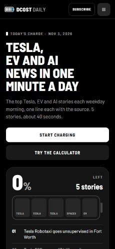
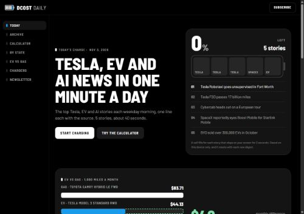

# Web audit, November 10, 2026

Scope: homepage mobile Lighthouse navigation, desktop layout capture, static route validation. Automated checks do not replace keyboard/screen reader and live signup testing.

| Signal | Production baseline | Patched local |
| --- | --- | --- |
| Accessibility | 95 | 100 |
| Footer heading order | Failed | Passed |
| Performance | 84; LCP 3.1 s; CLS 0 | 100 diagnostic score; origin/content differ, not a production speed claim |
| SEO / Best practices | 100 / 100 | 100 / 100 |

Changes:
- Use h2 footer group headings and preserve their visual styling. Update the shared generator and regenerate all 92 generated pages.
- Rename the generator asset version to ASSET_VERSION. gen_compare.py defines a function V in the same namespace, which previously leaked function addresses into comparison-page CSS/JS version URLs. All regenerated assets now use the intended version string.
- Start Beehiiv embeds when their newsletter section approaches the viewport. Observe the nonempty parent section, unobserve after triggering, keep the direct signup URL independent, and load immediately when IntersectionObserver is unavailable.
- Underline inline source links and let the wordmark's visible text supply its accessible name.

Verification: 6,693 internal asset/link targets and all sitemap routes resolve; no em dashes; node --check ui.js; newsletter proximity/non-intersection/fallback checks; final mobile Lighthouse accessibility 100. Screenshots captured at viewport widths 390 and 1280 (Lighthouse image output is downscaled).

Production is unchanged. Per CODEX.md, this change is proposed through a PR and must not be merged or deployed by the agent.

